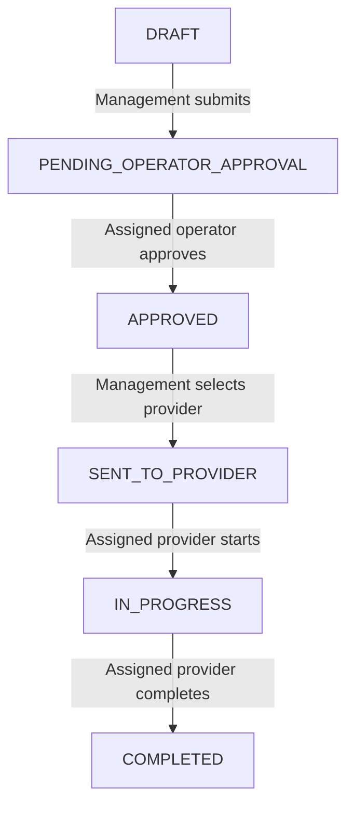

# Maintenance Request Reporting System

Role-based maintenance management prototype for the Department of Instrumentation and Automation Technology, Faculty of Technology, University of Colombo.

Milestone 5 adds an approval-controlled work-order workflow on top of the asset register and deadline alerts delivered in Milestones 3 and 4. Management creates and submits a request, the assigned Machine Operator approves external sharing, management selects a Service Provider, and that provider records progress, service details, and evidence metadata.

## Technology Stack

| Layer | Technology |
|---|---|
| Frontend | React, Vite, TypeScript |
| Backend | Node.js, Express, TypeScript |
| Database | PostgreSQL |
| ORM | Prisma |
| Logging | Pino and database audit records |
| Testing | Vitest, Supertest, React Testing Library |
| Local Run | Docker Compose |

## Project Structure

```text
maintenance-report-system/
  apps/
    api/
      prisma/
      src/
    web/
      src/
  docs/
  docker-compose.yml
  AGENTS.md
  README.md
```

## Milestone 5 Scope

1. Admin, Owner, and Manager create, edit, submit, dispatch, and cancel work orders.
2. A work order must be approved by the Machine Operator assigned to its machine before it can be shared externally.
3. Management selects an active Service Provider when dispatching an approved work order.
4. A Service Provider sees only work orders assigned to that account and only after approval.
5. The assigned provider starts and completes work and records completion date, cost, replaced parts, and notes.
6. The assigned provider records immutable evidence metadata for service reports, invoices, payment slips, photos, or other files.
7. Admin, Owner, and Manager can review completed service details and evidence.
8. Every successful workflow transition and service-data mutation writes an audit action.

Milestone 5 stores file metadata and an optional safe HTTP, HTTPS, or root-relative URL. Binary file storage and report generation remain outside this milestone.

## Work Order Lifecycle



Admin, Owner, or Manager can change any nonterminal order to `CANCELLED`.

## Work Order API Contract

| Method | Endpoint | Purpose | Access |
|---|---|---|---|
| `GET` | `/api/work-orders` | List role-scoped work orders | All authenticated roles |
| `GET` | `/api/work-orders/:id` | Read one visible work order | All authenticated roles |
| `GET` | `/api/work-orders/providers` | List active providers for dispatch | Admin, Owner, Manager |
| `POST` | `/api/work-orders` | Create a draft | Admin, Owner, Manager |
| `PATCH` | `/api/work-orders/:id` | Edit a draft | Admin, Owner, Manager |
| `POST` | `/api/work-orders/:id/submit` | Request operator approval | Admin, Owner, Manager |
| `POST` | `/api/work-orders/:id/approve` | Approve external sharing | Assigned Machine Operator |
| `POST` | `/api/work-orders/:id/send-to-provider` | Select provider and dispatch | Admin, Owner, Manager |
| `POST` | `/api/work-orders/:id/start` | Start assigned work | Assigned Service Provider |
| `PATCH` | `/api/work-orders/:id/service-details` | Save service date, cost, parts, notes | Assigned Service Provider |
| `POST` | `/api/work-orders/:id/evidence` | Add evidence metadata | Assigned Service Provider |
| `POST` | `/api/work-orders/:id/complete` | Complete assigned work | Assigned Service Provider |
| `POST` | `/api/work-orders/:id/cancel` | Cancel a nonterminal order | Admin, Owner, Manager |

Backend authorization is the security boundary. Frontend control visibility does not replace API permission checks.

## Windows PowerShell Setup

Docker Desktop must be open and its Linux container engine must be running. Stop running Node processes before Prisma generation on Windows so its query-engine DLL is not locked.

```powershell
Set-Location "C:\Users\Malith pamuditha\Desktop\maintenance-report-system"

Get-Process node -ErrorAction SilentlyContinue | Stop-Process -Force
docker compose up db -d

Copy-Item .env.example .env -Force
Copy-Item .env apps/api/.env -Force

npm install
npm run prisma:generate
npm run prisma:migrate
```

Milestone 5 adds the migration `20261110004315_add_work_order_replaced_parts`. It adds `WorkOrder.replacedParts` and must be applied to an existing Milestone 4 database.

Optional demonstration administrator seed:

```powershell
npm run seed --workspace apps/api
```

```text
Email: admin@example.com
Password: Admin@12345
```

The seed is for local demonstration only.

## Run Locally

Start the API and leave the PowerShell window open:

```powershell
npm run dev:api
```

In a second PowerShell window:

```powershell
Set-Location "C:\Users\Malith pamuditha\Desktop\maintenance-report-system"
npm run dev:web
```

Open the frontend at <http://localhost:5173> and API health at <http://localhost:4000/api/health>.

## Milestone 5 Demo Script

1. As Admin, create active Machine Operator and Service Provider accounts.
2. Assign the operator to a machine in the asset workspace.
3. Open Work Orders, create a draft for that machine, and submit it.
4. Sign in as the assigned operator and approve the pending work order.
5. Sign in as Admin, Owner, or Manager, select the provider, and send the order.
6. Sign in as that provider and confirm only assigned approved work is visible.
7. Start the work order, save service date, cost, replaced parts, and notes.
8. Add report, invoice, or payment-slip metadata and complete the work.
9. Sign in as management and review the completed details and evidence.
10. Confirm another operator or provider cannot access or mutate the order.

## Verification Commands

```powershell
npm run prisma:generate
npm run typecheck
npm test
npm run build
```

Milestone 5 automated integration verification passed on 2026-11-10: Prisma validation, API/web type checking, 66 API tests, 32 web tests, and both production builds completed successfully. Windows/Docker/PostgreSQL workflow and responsive browser checks remain for local sign-off in `docs/MILESTONE_5_QA.md`.

## Local Git Remote

The project can remain local by using the Desktop bare repository as `origin`. Commit only when requested and use the real current date and time; do not backdate or fabricate history.

```powershell
git remote set-url origin "C:\Users\Malith pamuditha\Desktop\maintenance-report-system-local-remote.git"
git status
```

## Milestone Status

- Milestone 1: monorepo, API/web foundations, Prisma schema, and Docker configuration.
- Milestone 2: authentication, first-admin setup, user administration, sessions, RBAC, and audit foundations.
- Milestone 3: machine, part, maintenance-plan, assignment, asset RBAC, audit, tests, and demo documentation.
- Milestone 4: alert scheduler, deduplication, reconciliation, role-scoped alerts, acknowledgement, and responsive alert UI.
- Milestone 5: operator-approved work orders, provider dispatch and visibility, progress updates, service details, evidence metadata, audit coverage, and responsive work-order UI complete; local Windows sign-off pending.
