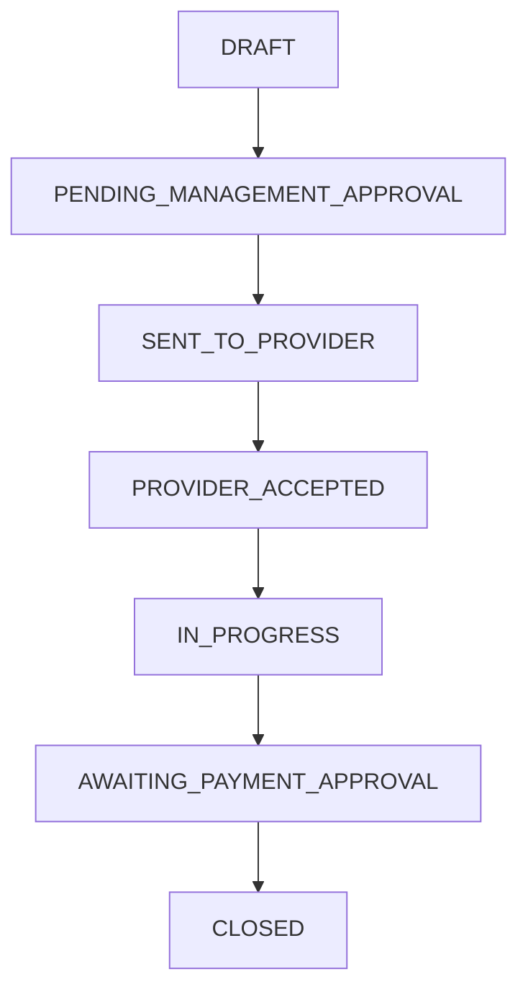

# Maintenance Request Reporting System

Role-based maintenance management for the Department of Instrumentation and Automation Technology, Faculty of Technology, University of Colombo.

Milestone 5.5 corrects the complete service path: an operator registers a machine and its due dates, responds to an alert, raises a categorized request, management assigns a provider, the provider records service and replacement warranty data, and management approves payment before the request closes and asset dates change.

The corrective update also fixes assigned-provider request access, adds hierarchical role-scoped recent activity, prevents alert action overlap, adds administrator/provider identity fields to the printable service receipt, and provides finalized payment analytics for management and service providers.

Budgeting is separated from actual service billing: management sets the proposed budget when dispatching, the provider enters the service/labour charge and priced replacement lines, and the system calculates the parts total, final total, and budget variance automatically for payment review.

## Technology

| Layer | Technology |
|---|---|
| Frontend | React, Vite, TypeScript |
| Backend | Node.js, Express, TypeScript |
| Database | PostgreSQL |
| ORM | Prisma |
| Testing | Vitest, Supertest, React Testing Library |
| Local environment | Docker Compose and Windows PowerShell |

## Milestone 5.5 workflow



`REJECTED` and `CANCELLED` are terminal alternatives. Legacy Milestone 5 statuses remain in the enum so existing records are readable.

## Roles

| Role | Capabilities |
|---|---|
| Admin | User administration plus all management review, dispatch, cancellation, and payment actions |
| Owner | Business review, dispatch, rejection, cancellation, and payment approval |
| Manager | Daily operational review, dispatch, rejection, cancellation, scheduler runs, and payment approval |
| Machine Operator | Create and maintain owned machines, parts, plans, dates, alerts, and service requests |
| Service Provider | View assigned dispatched work, accept, start, record service/replacements/evidence, and submit completion |

Owner and Manager overlap on service approvals so operations do not depend on one account. Admin remains the only user-administration role.

## Important API actions

| Method | Endpoint | Access |
|---|---|---|
| `POST` | `/api/work-orders` | Admin, Owner, Manager, Machine Operator |
| `POST` | `/api/work-orders/:id/submit` | Draft creator or authorized management |
| `POST` | `/api/work-orders/:id/approve-and-dispatch` | Admin, Owner, Manager |
| `POST` | `/api/work-orders/:id/reject` | Admin, Owner, Manager |
| `POST` | `/api/work-orders/:id/accept` | Assigned Service Provider |
| `POST` | `/api/work-orders/:id/start` | Assigned Service Provider |
| `PATCH` | `/api/work-orders/:id/service-details` | Assigned Service Provider |
| `POST` | `/api/work-orders/:id/replacements` | Assigned Service Provider |
| `POST` | `/api/work-orders/:id/evidence` | Assigned Service Provider |
| `POST` | `/api/work-orders/:id/submit-completion` | Assigned Service Provider |
| `POST` | `/api/work-orders/:id/approve-payment` | Admin, Owner, Manager |
| `PATCH` | `/api/alerts/:id/reopen` | Alert reader in scope |
| `GET` | `/api/dashboard/activity` | Authenticated; audit events are scoped to the role's records |
| `GET` | `/api/dashboard/payments` | Admin, Owner, Manager, Service Provider; provider results are assigned-only |
| `GET` | `/api/organization-profile` | Authenticated |
| `PATCH` | `/api/organization-profile` | Admin |

Backend authorization is the security boundary. Hidden frontend controls do not replace API permission checks.

## Windows installation

Open Docker Desktop first. Then run from PowerShell:

```powershell
Set-Location "C:\Users\Malith pamuditha\Desktop\maintenance-report-system"

Get-Process node -ErrorAction SilentlyContinue | Stop-Process -Force
docker compose up db -d

Copy-Item .env.example .env -Force
Copy-Item .env apps/api/.env -Force

npm install
npm run prisma:generate
npm run prisma:migrate
npm run typecheck
npm test
npm run build
```

Milestone 5.5 adds migration `20261110023000_milestone_5_5_workflow`. The corrective updates add `20261111190000_activity_and_receipt_identity`, `20261112001500_proposed_budget_and_actual_total`, and `20261112013000_payment_counter_negotiation`. They preserve existing records while adding receipt identity, separate service-cost storage, and repeatable owner/manager price counteroffers; the existing `cost` database column is retained as the current management-proposed budget.

Optional local administrator seed:

```powershell
npm run seed --workspace apps/api
```

```text
Email: admin@example.com
Password: Admin@12345
```

## Run locally

Keep this first PowerShell window open:

```powershell
npm run dev:api
```

Open a second PowerShell window:

```powershell
Set-Location "C:\Users\Malith pamuditha\Desktop\maintenance-report-system"
npm run dev:web
```

Frontend: <http://localhost:5173>  
API health: <http://localhost:4000/api/health>

## Acceptance scenario

The complete role-by-role walkthrough is in `docs/MILESTONE_5_5_USER_SCENARIO.md`.

After the API is running, execute the live database-backed scenario:

```powershell
powershell -ExecutionPolicy Bypass -File .\scripts\milestone-5-5-live-scenario.ps1
```

It creates uniquely named local test users and records. It passes only after verifying the payment alert, closed request, replacement warranty dates, role-private activity feeds, management outflow, and provider inflow.

## Verification

```powershell
npm run prisma:generate
npm run typecheck
npm test
npm run build
```

See `docs/MILESTONE_5_5_QA.md` for the observed results and remaining Windows live sign-off.

## Local Git policy

The project may use the local Desktop bare repository as `origin`. Do not commit unless requested. Use the real current date and time; do not backdate or fabricate history.

```powershell
git remote set-url origin "C:\Users\Malith pamuditha\Desktop\maintenance-report-system-local-remote.git"
git status
```
