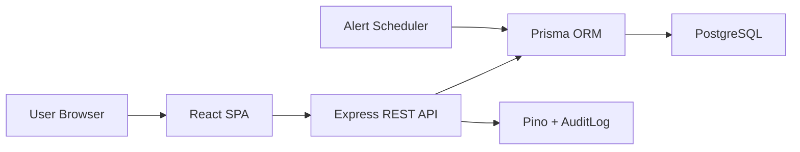
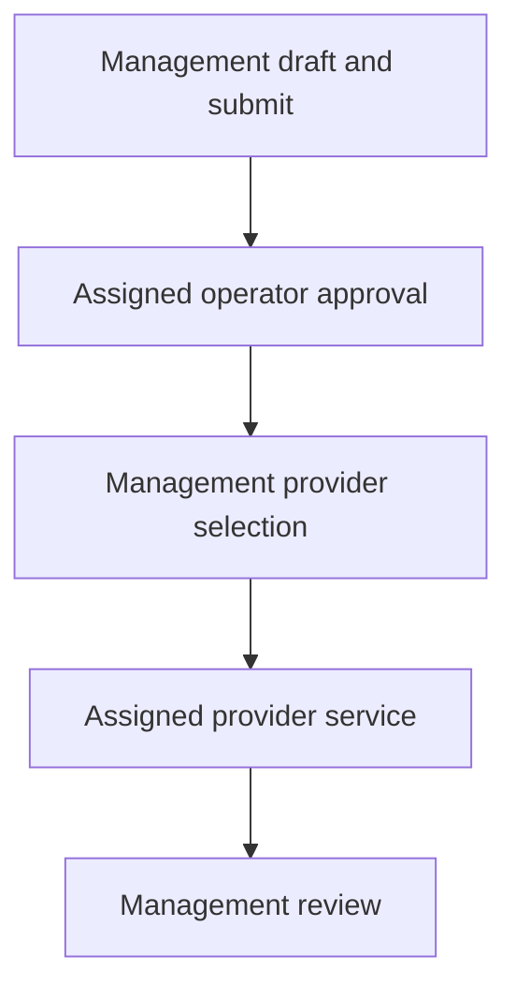

# Architecture

The system uses a modular monolith architecture.

## Components

| Component | Responsibility |
|---|---|
| React SPA | Role-aware asset, alert, and work-order workspaces |
| Express API | Authentication, RBAC, workflow transitions, validation, and audit orchestration |
| Prisma ORM | Typed database access, transactions, and migration history |
| PostgreSQL | Relational data, ownership links, workflow state, and evidence metadata |
| Alert scheduler | Daily deadline evaluation, deduplication, and reconciliation |
| Audit layer | Security, asset, alert, and work-order action history |

## Milestone 5 Workflow Boundary

Work orders remain inside the API modular monolith. Transition rules live in the work-order service, not in the React UI. Each transition reads the current record, verifies the authenticated role and relationship, performs the state update, and creates its audit record in one database transaction.

## Authorization Boundary

| Actor | Backend scope |
|---|---|
| Admin, Owner, Manager | All work orders; management mutations and dispatch |
| Machine Operator | Work orders for assigned machines; approval only while pending |
| Service Provider | Assigned orders after approval; start, service details, evidence, completion |

Providers cannot discover drafts or pending approvals. Operators cannot approve a work order for a machine assigned to someone else. Provider assignment occurs during the approved-to-dispatched transition.

## State Rules

The normal path is `DRAFT -> PENDING_OPERATOR_APPROVAL -> APPROVED -> SENT_TO_PROVIDER -> IN_PROGRESS -> COMPLETED`. Management can cancel any nonterminal order. Draft editing is restricted to management; provider service details are accepted only for assigned dispatched or in-progress work.

Evidence rows are append-only in Milestone 5. They store type, file name, optional URL, notes, uploader, and timestamp. Binary upload storage, evidence replacement, and evidence deletion are deferred.

## Audit Boundary

Milestone 5 records `WORK_ORDER_CREATED`, `WORK_ORDER_UPDATED`, `WORK_ORDER_SUBMITTED`, `WORK_ORDER_APPROVED`, `WORK_ORDER_SENT_TO_PROVIDER`, `WORK_ORDER_STARTED`, `WORK_ORDER_COMPLETED`, `WORK_ORDER_CANCELLED`, `WORK_ORDER_SERVICE_DETAILS_UPDATED`, and `SERVICE_EVIDENCE_ADDED`.

## Architecture Decision

The project remains a modular monolith rather than adding a queue or separate work-order service. This keeps transactional authorization and audit behavior clear for the prototype while preserving module boundaries for later extraction if needed.
