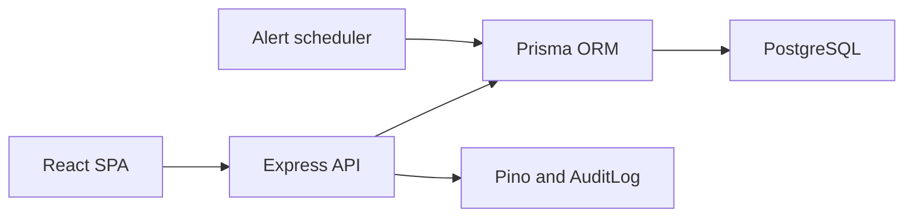
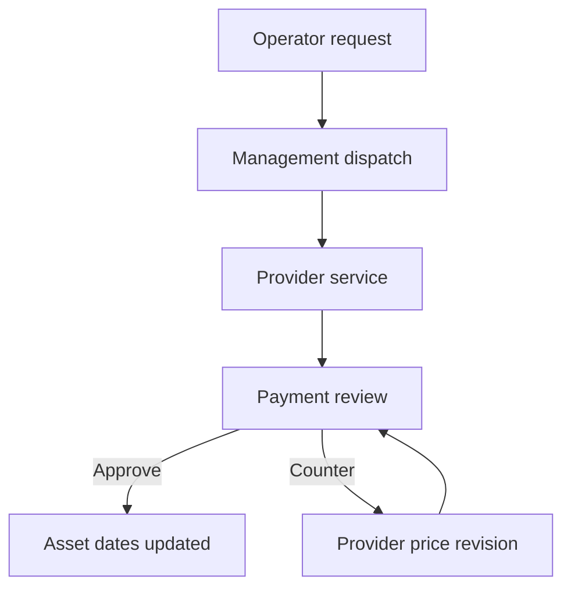

# Architecture

The system is a modular monolith: a React SPA calls an Express REST API, which uses Prisma and PostgreSQL. Transition rules and authorization live in backend services, not in the UI.

## Milestone 5.5 workflow boundary

Each transition loads the current order inside a serializable transaction, verifies status plus the actor's role and relationship, applies the mutation, and writes its audit event.

## Authorization boundary

| Actor | Backend scope |
|---|---|
| Admin, Owner, Manager | All requests; review, dispatch, rejection, cancellation, and payment approval |
| Owner, Manager | Price counteroffer with revised budget and reason |
| Machine Operator | Own assigned machines; asset dates, alerts, and requests for that scope |
| Service Provider | Assigned dispatched-or-later requests; acceptance, service, replacement, evidence, completion |

Providers cannot discover drafts or management-review records. Assigned work orders include the safe machine-part context the provider needs, so the provider UI never calls operator-only asset endpoints. Operators cannot create requests for another operator's machine or assign providers. Payment approval is management-only.

## State rules

The new path is:

`DRAFT -> PENDING_MANAGEMENT_APPROVAL -> SENT_TO_PROVIDER -> PROVIDER_ACCEPTED -> IN_PROGRESS -> AWAITING_PAYMENT_APPROVAL -> CLOSED`

During payment review, an Owner or Manager may branch to `PRICE_REVISION_REQUESTED`. The provider may edit service/labour cost and replacement quantity or unit cost, then resubmit to `AWAITING_PAYMENT_APPROVAL`. This loop can repeat until management approves.

Management can reject a pending request or cancel a nonterminal request. Terminal requests cannot move backward. Legacy statuses remain supported for existing rows.

Provider completion creates a `PAYMENT_APPROVAL` alert. Payment approval resolves that alert, applies each `WorkOrderReplacement` warranty and next-replacement date to `MachinePart`, and closes the order in the same transaction.

## Financial calculation

Management records the proposed budget during provider dispatch. The provider cannot overwrite it. During service, the provider records a service/labour charge and one or more replacement lines. Existing machine parts can be selected, and extra or unlisted parts can be added without a `machinePartId`.

`parts total = sum(quantity x unit cost)`

`final total = service/labour charge + parts total`

`budget variance = final total - proposed budget`

The payment alert and audit events include the calculated values. Completion is blocked until the service charge and every replacement unit cost are present.

A management counteroffer updates the current proposed budget and stores an immutable `WorkOrderPriceCounter` history row containing the reviewed provider total, counter budget, reason, author, and response time. The counter budget is a negotiation target, not an equality constraint. The provider's revised final total may remain above or below it when the receipt is resubmitted.

## Activity, payments, evidence, and printing

The overview reads `AuditLog` through an explicit actor hierarchy:

| Viewer | Visible audit actors |
|---|---|
| Admin | Every role |
| Owner | Owner, Manager, and Machine Operator |
| Manager | Manager and Machine Operator |
| Machine Operator | Only the signed-in operator |
| Service Provider | Only the signed-in provider |

The payment dashboard is available to Admin, Owner, Manager, and Service Provider. Management roles see all finalized payments as organization cash outflow; a provider sees only payments for work orders assigned to that provider as cash inflow. Payment value, replaced parts, machine, provider, approver, payment date/reference, proposed budget, variance, and monthly totals are derived from approved `CLOSED` work orders.

Evidence stores metadata, uploader, and an optional safe HTTP, HTTPS, or root-relative URL. Binary storage remains outside this milestone. The frontend produces a printable service slip from persisted request, service, replacement, cost, evidence, organization identity, and provider invoice data.

## Audit boundary

Milestone 5.5 adds audit actions for management dispatch/rejection, provider acceptance, replacement add/update/remove, completion submission, price counteroffers, payment approval, and alert reopen. Existing asset, alert, authentication, and legacy work-order actions remain intact.

## Architecture decision

The project remains a modular monolith. This keeps authorization, state transitions, part-date updates, payment-alert resolution, and audit recording atomic while preserving module boundaries for future extraction.
