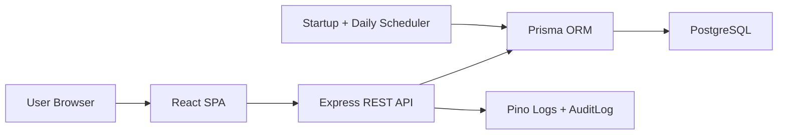
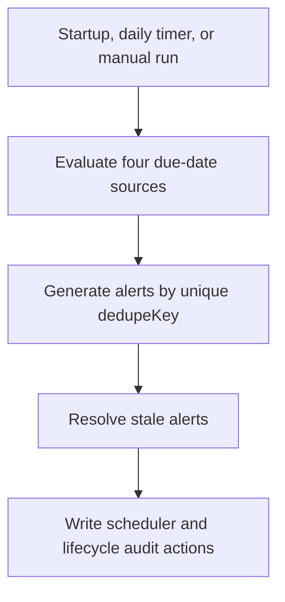

# Architecture

The system uses a modular monolith architecture.

## Components

| Component | Responsibility |
|---|---|
| React SPA | Role dashboards, asset screens, alert list and acknowledgement controls |
| Express API | Authentication, RBAC, CRUD, alerts, reports, and business rules |
| Prisma ORM | Typed database access, transactions, and migrations |
| PostgreSQL | Relational storage and the unique alert deduplication constraint |
| Alert scheduler | Daily due-date evaluation, alert generation, and stale-alert reconciliation |
| Audit layer | Security and business actions, including scheduler and alert lifecycle events |
| Swagger | API contract documentation |

## Milestone 4 Scheduler Boundary

The scheduler remains inside the API modular monolith. It is not a separate microservice. The API starts one scheduler process at application startup and schedules subsequent runs once per day while that API process remains active. The default daily time is 01:00 in `Asia/Colombo`; `ALERT_SCHEDULER_HOUR` and `ALERT_SCHEDULER_TIMEZONE` configure it.

The same scheduler service is called by both automatic execution and `POST /api/alerts/run-scheduler`. The route adds Admin/Manager authorization and a user actor; it does not duplicate deadline logic.

## Deadline Evaluation

| Source | Alert type | Warning threshold |
|---|---|---|
| `Machine.warrantyEnd` | `MACHINE_WARRANTY` | 7 days by default |
| `MachinePart.warrantyEnd` | `PART_WARRANTY` | 7 days by default |
| `MachinePart.replacementDue` | `PART_REPLACEMENT` | 7 days by default |
| `MaintenancePlan.nextDueDate` | `MAINTENANCE_DUE` | The plan's `thresholdDays` value |

Only `ACTIVE` and `UNDER_MAINTENANCE` machines participate. Parts and plans inherit that machine eligibility. Only active maintenance plans are evaluated, and optional machine/part dates are skipped when absent.

## Idempotency and Reconciliation

Each due event has a deterministic `dedupeKey` derived from its alert type, source record, and due event. `Alert.dedupeKey` is unique in PostgreSQL, so repeated, overlapping, or manually triggered runs cannot create a second alert for the same event.

After generation, the scheduler reconciles existing active alerts against current source data. If the source no longer qualifies because its date changed, its date was cleared, its maintenance plan became inactive, or its machine is no longer alertable, the alert changes to `RESOLVED` and receives `resolvedAt`. A changed due date is treated as a new due event, allowing a new dedupe key when it becomes eligible. If the exact same due event later qualifies again, its existing resolved alert is reopened instead of duplicated.

## API and Authorization Boundary

| Endpoint | Authorization behavior |
|---|---|
| `GET /api/alerts` | Admin, Owner, and Manager receive all alerts; Machine Operator receives assigned-machine alerts; Service Provider is denied |
| `PATCH /api/alerts/:alertId/acknowledge` | The same visibility rules are enforced before acknowledgement |
| `POST /api/alerts/run-scheduler` | Admin and Manager only |

All role filtering is enforced by the Express API. Frontend visibility is only a usability layer.

## Audit Boundary

The scheduler and alert routes create `ALERT_GENERATED`, `ALERT_RESOLVED`, `ALERT_ACKNOWLEDGED`, and `ALERT_SCHEDULER_RUN` records. Automatic scheduler actions may use a null actor; manual scheduler runs and acknowledgements use the authenticated actor.

## Architecture Decision

The project uses a modular monolith, not microservices. This keeps the prototype realistic for a three-member university team while separating frontend, API, scheduler, reporting, and database responsibilities. Milestone 4 does not require an external queue, hosted cron service, or messaging provider.
