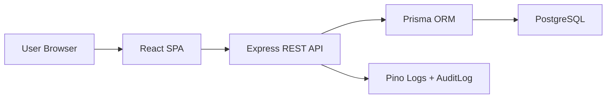

# Architecture

The system uses a modular monolith architecture.

## Components

| Component | Responsibility |
|---|---|
| React SPA | Role dashboards, forms, validation, report downloads |
| Express API | Auth, RBAC, CRUD, alerts, reports, business rules |
| Prisma ORM | Typed database access and migrations |
| PostgreSQL | Relational storage for system records |
| Scheduler | Daily checks for warranty, replacement, and maintenance deadlines |
| Swagger | Baseline API documentation; health is currently annotated |

## Architecture Decision

The project uses a modular monolith, not microservices. This keeps the prototype realistic for a three-member university team while still separating frontend, API, scheduler, reporting, and database responsibilities.
